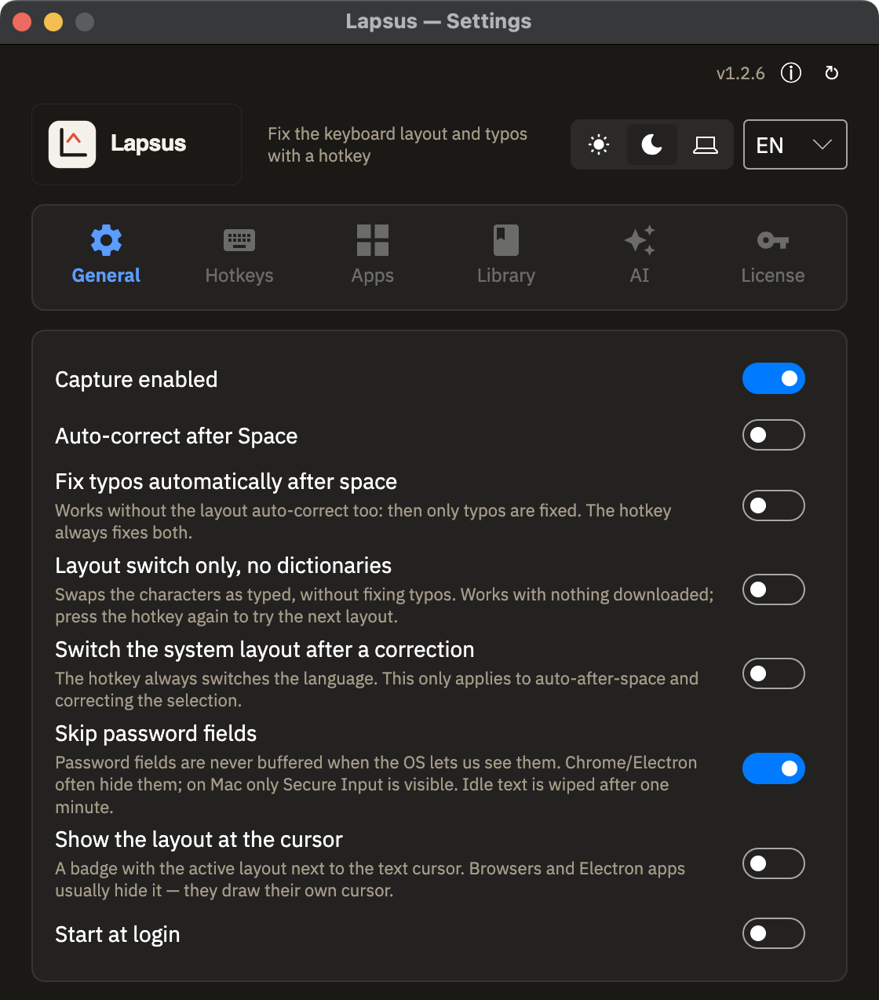
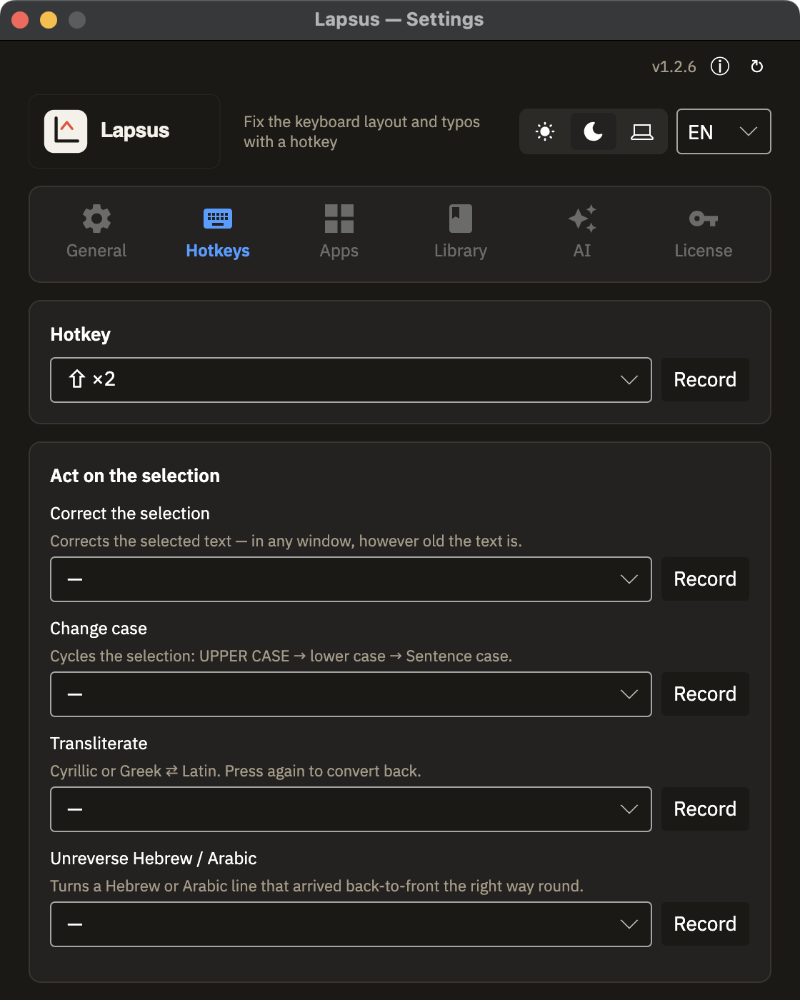
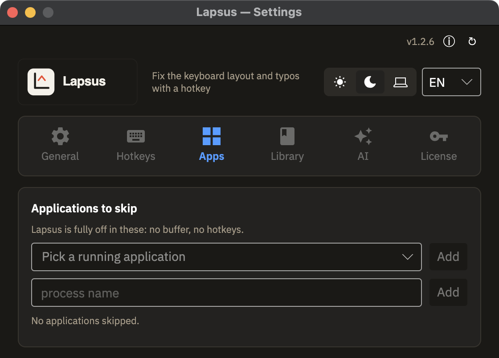
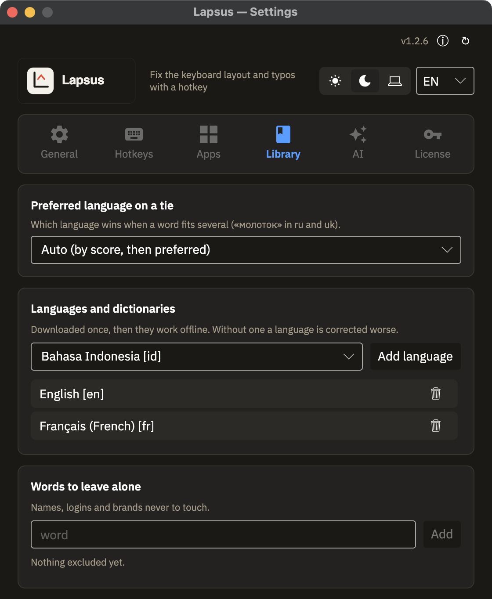
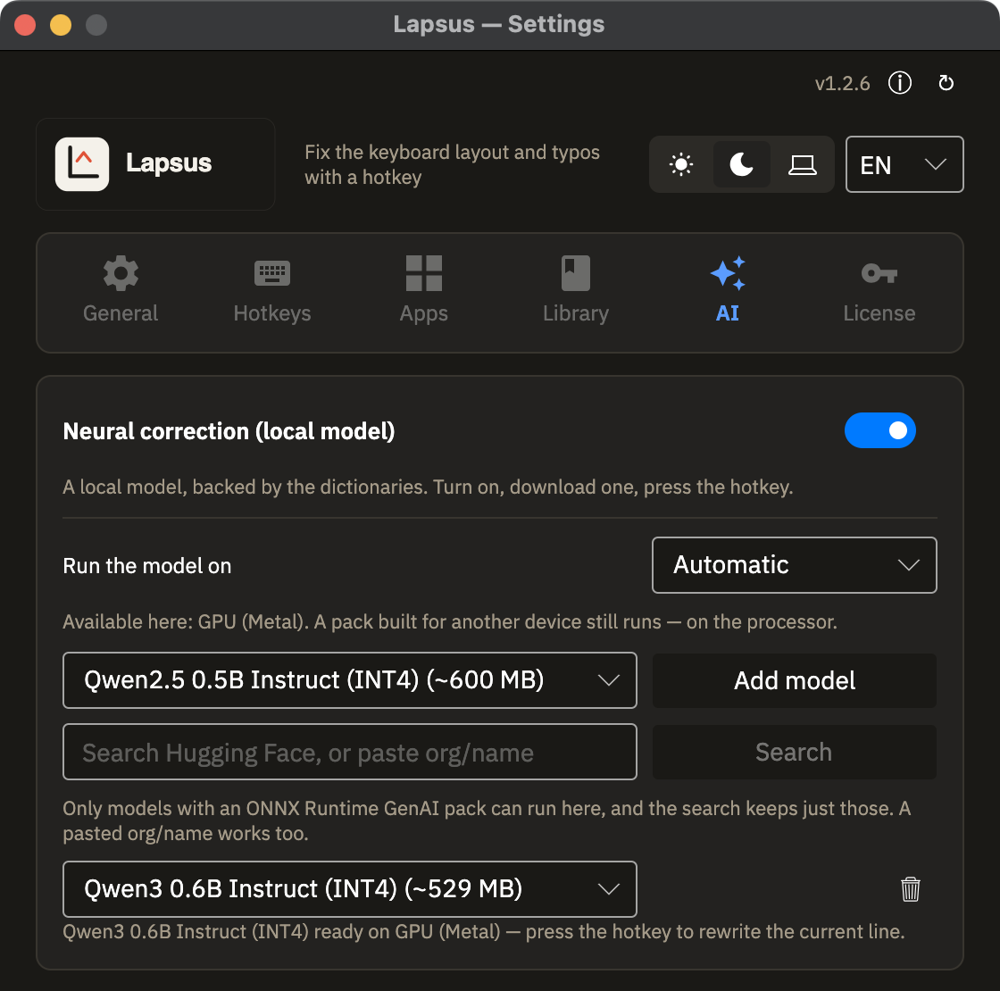

<div align="center">

<picture>
  <source media="(prefers-color-scheme: dark)" srcset="Lapsus/Assets/theme-dark.svg">
  
</picture>

### Types the word you meant, not the keys you hit.

Wrong-layout and typo corrector for Windows and macOS. Lives in the tray, works over any app,
runs entirely on your machine.

[](https://getlapsus.com/)
[](https://github.com/AleksandrPidlozhevich/Lapsus/releases)
[](#install)
[](https://dotnet.microsoft.com/)
[](https://avaloniaui.net/)
[](#privacy)
[](LICENSE)

</div>

---

The keys were right and the layout was wrong. Press one key and the line is
repaired in place — no retyping, and no waiting on the OS to switch layout.

| You typed | You get | What that takes |
|-----------|---------|-----------------|
| `dsnfyyz` | `вітання` | positional remap between installed layouts |
| `kalhmera` | `καλημέρα` | remap **plus** a typo fix (SymSpell, edit distance ≤ 2) |
| `akuo` | `שלום` | a final letter on its own key |
| `lvpfh` | `مرحبا` | positional remap, right to left |
| `ghbdtn` | `привет` | positional remap on the Russian layout |
| `;ovek` | `čovek` | č on the semicolon key, Serbian Latin |
| `gamarjoba` | `გამარჯობა` | a phonetic layout, letters reached through Shift |
| `sch;n` | `schön` | one mistyped key between two Latin layouts |
| `n'rcn` in `прывітанне, свет n'rcn` | `тэкст` | only the tail is wrong; the rest is left alone |
| `hello,` | `hello,` | a real word stays a real word |

Six writing systems: **Latin, Cyrillic, Greek, Hebrew, Arabic, Georgian**.

## Screenshots

<table>
  <tr>
    <td width="50%"></td>
    <td width="50%"></td>
  </tr>
  <tr>
    <td align="center"><b>General</b> — capture, auto-correct, what a key does to a line</td>
    <td align="center"><b>Hotkeys</b> — the main key, plus keys for a selection</td>
  </tr>
  <tr>
    <td></td>
    <td></td>
  </tr>
  <tr>
    <td align="center"><b>Apps</b> — programs Lapsus stays out of entirely</td>
    <td align="center"><b>Library</b> — downloadable word lists, tie-break language</td>
  </tr>
  <tr>
    <td></td>
    <td></td>
  </tr>
  <tr>
    <td align="center"><b>AI</b> — optional local model, CPU or GPU, your choice</td>
    <td></td>
  </tr>
</table>

The Mac App Store edition has the same window plus a Plus tab; its screenshots are in
[`docs/images/appstore`](docs/images/appstore).

## What it can do

- **Fix the current line** on a hotkey. Press again to cycle the other readings, and again to get
  back exactly what you typed.
- **Fix a word automatically** after Space (opt-in), behind a filter that leaves `myVar`, URLs,
  ALL-CAPS and very short words alone — unless the line has already switched, in which case `d`
  follows it as `в`. Out of the box it only switches layouts; fixing typos on the fly is a second
  switch, because a name one letter from a dictionary word is not a typo.
- **Fix a selection** — any text, any age, even after a mouse click, through a borrowed clipboard
  that is handed back exactly as it was.
- **Three more things a key can do to a selection**, each with its own hotkey and none of them
  needing a dictionary: cycle **case** (UPPER → lower → Sentence, Greek final sigma included),
  **transliterate** Cyrillic or Greek ⇄ Latin in each language's own romanisation — Ukrainian's 2010
  rules (Київ → Kyiv), Bulgaria's 2009 Streamlined System (Търново → Tarnovo), Belarusian, Macedonian,
  Russian, and ELOT 743 for Greek, the one on Greek passports — and turn a **visually reversed**
  Hebrew or Arabic line back the right way round.
- **Show which layout is active** right next to the text cursor (opt-in), so the mistake
  does not happen in the first place. Apps that draw their own cursor (browsers, Electron)
  do not report a caret, on either OS.
- **Type by voice** (opt-in): hold Ctrl+Win (⌃⌥ on a Mac) while you speak and let go, and what you
  said is typed at the cursor; a short press records hands-free until the next one. English terms in Russian or Ukrainian speech come
  out as *pull request* and *GitHub*, not spelled out in Cyrillic, and a glossary teaches it your own
  names. [More below.](#voice-typing-optional)
- **Stay out of the way**: named applications are skipped entirely, password fields never reach the
  buffer, and IME input (Chinese / Japanese / Korean) is left to the IME.
- **Speak your language**: the interface ships in 26 languages, right-to-left ones included.

### Three brains, one hotkey

| Brain | Needs | What it does |
|-------|-------|--------------|
| **Dictionary** (default) | a word list | Ranks every reading — as typed, remapped through each installed layout, each also typo-fixed — and switches only past a confidence threshold. |
| **Layout switch only** | nothing at all | One character for another. No word list, no threshold: you pressed the key, and that is the whole decision. |
| **Neural** (opt-in) | a local model | A small instruct LLM rewrites the whole fragment, with the dictionary brain riding along as its adviser when a word list is installed — and standing in for it while the model is not loaded. |

## Install

From [getlapsus.com](https://getlapsus.com/) or the [latest GitHub release](https://github.com/AleksandrPidlozhevich/Lapsus/releases):

- **Windows** — `Lapsus-win-Setup.exe`. Per-user install into `%LocalAppData%\Lapsus`: no admin, no
  UAC prompt. It is unsigned, so SmartScreen says *"Windows protected your PC"* until the installer
  earns reputation — *More info* → *Run anyway*. `Lapsus-win-Portable.zip` is published too.
- **Windows, managed deployment** — `Lapsus-win.msi`, for Group Policy / Intune / SCCM.
  [See below.](#deploying-the-msi)
- **macOS** — the installer from the same release. Grant **Accessibility** and **Input Monitoring**
  on first run (System Settings → Privacy & Security); both are required for capture.

Nothing else to install: the builds are self-contained. Updates are checked in the background and
applied from the tray menu when you ask for them — the app never restarts itself mid-sentence.

### Deploying the MSI

Double-clicked, the MSI asks whether to install for this user or for the machine. Silently, it
installs **per-user** and — ordinary Windows Installer behaviour, not a Lapsus quirk — picks the
fixed drive with the most free space, so `/qn` alone can land the app in `D:\Lapsus`. Always name
the location:

```cmd
:: per-machine, into Program Files (requires elevation)
msiexec /i Lapsus-win.msi /qn ALLUSERS=1 VELOPACK_INSTALLDIR="C:\Program Files\Lapsus"

:: per-user, no elevation
msiexec /i Lapsus-win.msi /qn VELOPACK_INSTALLDIR="%LocalAppData%\Lapsus"
```

The MSI hides its own Add/Remove Programs entry so the app's is the only one visible, and
uninstalling runs the same cleanup hook `Setup.exe` does — the autostart entry goes with it, while
`%APPDATA%\Lapsus` (settings, dictionaries, models) is deliberately kept for a reinstall.

Individuals should take `Setup.exe`: a per-machine install lives somewhere the app cannot write to,
so in-app updates would need elevation. Under a deployment tool updates are the tool's job anyway —
push the next MSI.

## How it works

1. **Capture** — the platform backend tracks the current line in its own buffer
   (`WH_KEYBOARD_LL` on Windows, `CGEventTap` on macOS).
2. **Hypotheses** — the text as typed; remapped through every installed layout; each of those also
   typo-fixed.
3. **Score** — a dictionary hit wins outright; otherwise a character-trigram model built from the
   installed word lists judges how natural the word looks, times an edit penalty, and a switch happens
   only past a threshold. Scripts that cannot be scored honestly — Hebrew, Arabic, Georgian — are
   dictionary-only by design.
4. **Inject** — the backspaces and the replacement go out as **one** `SendInput` call, as Unicode.
   Nothing waits on an OS layout switch, which is the lag every switcher of this kind is known for.
5. **Optionally** — ask the OS once, afterwards, to switch to the target layout so that continued
   typing matches.

## Dictionaries

Not bundled, and no network traffic until you click Download. In **Settings → Library**, pick from
**33** languages across the six scripts:

- a frequency list — [hermitdave/FrequencyWords](https://github.com/hermitdave/FrequencyWords) for most
  languages, Unicode Unilex for Belarusian and Georgian;
- for most of them also a Hunspell dictionary, so a rare word form no frequency list reaches still counts as a
  word — from [LibreOffice](https://github.com/LibreOffice/dictionaries) or
  [wooorm/dictionaries](https://github.com/wooorm/dictionaries); Hebrew's word forms come from Wiktionary
  ([kaikki.org](https://kaikki.org/dictionary/Hebrew/)) and [UniMorph](https://github.com/unimorph/heb) instead.

Sources are pinned to a commit, and every one, with its authors and license, is listed in
[THIRD-PARTY-NOTICES.md](THIRD-PARTY-NOTICES.md) and in the tooltip of an installed language. Word lists are
pooled by script, so a word counts as real if any loaded dictionary of its script knows it. Files live in
`%APPDATA%\Lapsus\dictionaries` (platform-equivalent on macOS) — outside the install folder, so an update never
wipes them.

## Local models (optional)

**Settings → AI** turns the neural brain on and manages models. Four curated ONNX Runtime GenAI
packs — Qwen3 0.6B (the default), Qwen2.5 0.5B, Qwen3 1.7B, Phi-3.5 mini — plus a search box that
takes either words or a pasted `org/name` from Hugging Face and keeps only the repos that really
hold a runnable pack.

The **device is your choice** (Auto / CPU / GPU), and the picker offers only what the machine can
really drive: DirectML on Windows, WebGPU on Apple Silicon, CUDA where a pack ships it, always with
a fall back to CPU. A short correction costs roughly a third of a second on a small pack, because
the prompt is built to stay identical from press to press and is rewound instead of re-fed.

Files land in `%APPDATA%\Lapsus\models\{id}`, beside the dictionaries and equally safe from an
update.

## Voice typing (optional)

**Settings → Voice** turns it on and downloads the speech model; the hotkey is on the Hotkeys tab with
the others. Hold it while you speak and let go, or tap it once to talk hands-free and tap again to finish —
Esc throws the recording away. A badge with a microphone sits at the cursor while it listens, saying how to
finish for the first few seconds, and a short tone marks the start and the end (it can be turned off).
On Windows a small microphone button waits at the bottom of the screen, labelled with the hotkey: a click
starts or finishes a dictation without taking focus from the field you are in. The password-field setting
does not apply here — dictation reads nothing from the field, it only types into it.

- **Recognition** is OpenAI's [Whisper](https://github.com/openai/whisper) large-v3-turbo through
  [whisper.cpp](https://github.com/ggml-org/whisper.cpp), on the graphics card where there is one
  (Vulkan on Windows: NVIDIA, AMD and Intel alike; Metal on Apple Silicon) and on the processor
  otherwise. On a mid-range GPU a phrase
  takes about a third of a second; on an 8-core CPU, two to three seconds. Four builds are offered —
  large-v3-turbo (834 MB, the default), the same model as a smaller download (547 MB), the full large-v3
  (1031 MB: on our test phrases 7.1% word errors and 19 of 25 English terms right against turbo's 9.3% and
  17, at about 0.8 s a phrase on a mid-range GPU and 5 s on a CPU), and Whisper small (181 MB) for computers
  without a graphics card.
- **Long dictations are typed as you go.** Once a few seconds have been said, the next pause sends that
  part to recognition and it is typed while you keep talking; the earlier parts are Whisper's context for
  the next. While the hotkey is held the parts wait (letters typed with Ctrl down would act as shortcuts)
  and go in the moment you let go, so only the last part is waited for.
- **English terms stay English.** Whisper is shown a sentence that mixes your language with English the
  way people speak, then a second pass puts terms it still spelled out back into Latin by how they sound
  (`пулл реквест` → `pull request`, `гитхаб` → `GitHub`), using the English word list and a built-in list
  of tech names. Words your dictionary knows (`компьютер`, `файл`) and inflected forms (`задеплоил`) are
  left alone. The glossary takes your own: one per line, `Kubernetes|кубер` when it sounds unusual.
- **Silence stays silent.** Speech is cut out with [Silero VAD](https://github.com/snakers4/silero-vad)
  before recognition, and the subtitle credits Whisper likes to invent over quiet audio are filtered out.
- **The language** is your active keyboard layout's, or another of your layouts' languages when the
  speech is clearly in it — never one you do not use. It can also be fixed.
- **Memory**: the model (about 1 GB) loads when a dictation starts — the microphone opens at once, so no
  word is lost while it loads — and is freed after five idle minutes, or whenever you choose.
- **On a Mac** the first dictation asks for the microphone (System Settings → Privacy & Security →
  Microphone). The input device is the system's; picking another one in Lapsus is Windows-only for now.

Models land in `%APPDATA%\Lapsus\speech`, each pinned to a commit and checked against its SHA-256.

## Build & run

```bash
dotnet restore Lapsus.slnx
dotnet build   Lapsus.slnx
dotnet run --project Lapsus/Lapsus.csproj
dotnet test    Lapsus.slnx
```

Requires the [.NET 10 SDK](https://dotnet.microsoft.com/download). Keyboard capture needs Windows or
macOS; on Linux the app runs with a no-op backend, so the UI and the core work but nothing is
captured yet.

Building the installers ([Velopack](https://velopack.io), one script per platform) is walked through
step by step in **[scripts/BUILDING.md](scripts/BUILDING.md)**.

## Privacy

Correction runs locally, the neural model included, and so does voice typing: the recording stays in
memory until its text is typed and is never written to disk or sent anywhere. There is no telemetry, no
analytics and no account, and what you type never leaves your computer. Password fields are skipped wherever the OS
lets us see them, the typing buffer is overwritten when it is dropped, and it is thrown away after
one minute of silence.

The app goes online for exactly these, and nothing else:

| When | Where | What it sends |
|------|-------|---------------|
| You install or update a dictionary | `raw.githubusercontent.com`, `kaikki.org` | an ordinary download request |
| You search for or download a neural model, or download the speech model | `huggingface.co` | the search text you typed; an ordinary download request |
| At launch (not in the Microsoft Store version, which the Store updates) | GitHub Releases | an update check |
| You enter a license key, and about once a month after that | the license server (Supabase) | the key, and a salted SHA-256 hash of the machine's ID — the raw ID never leaves the computer |

The machine hash cannot be reversed into a serial number and is salted per product, so it correlates
with nothing outside Lapsus; a free install never contacts the license server at all. If it is
unreachable, nothing breaks — the app keeps correcting text.

Every one of those servers sees your IP address, as any download does. Settings, the leave-alone word
list, excluded apps, the license key, dictionaries, models and the crash log stay on your computer in
the app-data folder (`%APPDATA%\Lapsus` on Windows); the Microsoft Store version keeps
them in its own package folder and deletes them when it is uninstalled. Full policy:
[getlapsus.com/en/privacy/app](https://getlapsus.com/en/privacy/app/).

## Not done yet

- **Linux backend** (evdev / uinput) — the UI and settings run, but nothing is captured.- **Word-bigram context ranking** — next.
- **Greek accents through the dead key on macOS** (`kal;ow` → καλός) — works on Windows only for now.
- **macOS notarization** — outstanding.

## Project layout

- `Lapsus.Core` — the OS-independent brain: layouts, spelling, correction, typing buffer, text transforms
- `Lapsus.Core.Tests` — xUnit coverage of the core
- `Lapsus` — the Avalonia tray UI, the Windows / macOS input backends, the ONNX GenAI host
- `Lapsus.Speech` — the Whisper host behind voice typing
- `Lapsus.Tests` — the app-layer decisions that need no OS

## Free for private people, paid for companies

**Private people use Lapsus for free — freelancers included.** Companies pay, per seat, after thirty
days to evaluate. The line is who uses it, not what for: no feature is locked behind a key, nothing
expires, and there is no copy protection.

At launch Lapsus checks whether the computer is administered by an organisation (an Active Directory
domain, Entra ID, or an MDM server). If it is and no key is installed, a small window says a license is
needed. It is a reminder, not a gate: nothing is disabled.

A license is tied to one computer. Editions, prices and a 30-day trial key are on the
[pricing page](https://getlapsus.com/en/pricing/); for a site license or a written agreement, write to
<info@getlapsus.com>.

## License

[Business Source License 1.1](LICENSE), unmodified apart from the Parameters block. Its **Additional
Use Grant** makes production use free for natural persons, and for private use of a work computer
where the organisation allows it; organisations need a paid, per-seat license. Four years after each
version is published, that version converts to the **Mozilla Public License 2.0**.
[COMMERCIAL-USE.md](COMMERCIAL-USE.md) explains the line in plain language; where the two differ,
`LICENSE` governs.

The components Lapsus ships keep their own licenses, reproduced in
[THIRD-PARTY-NOTICES.md](THIRD-PARTY-NOTICES.md). Dictionary and model packs are not bundled and keep
their upstream licenses.
