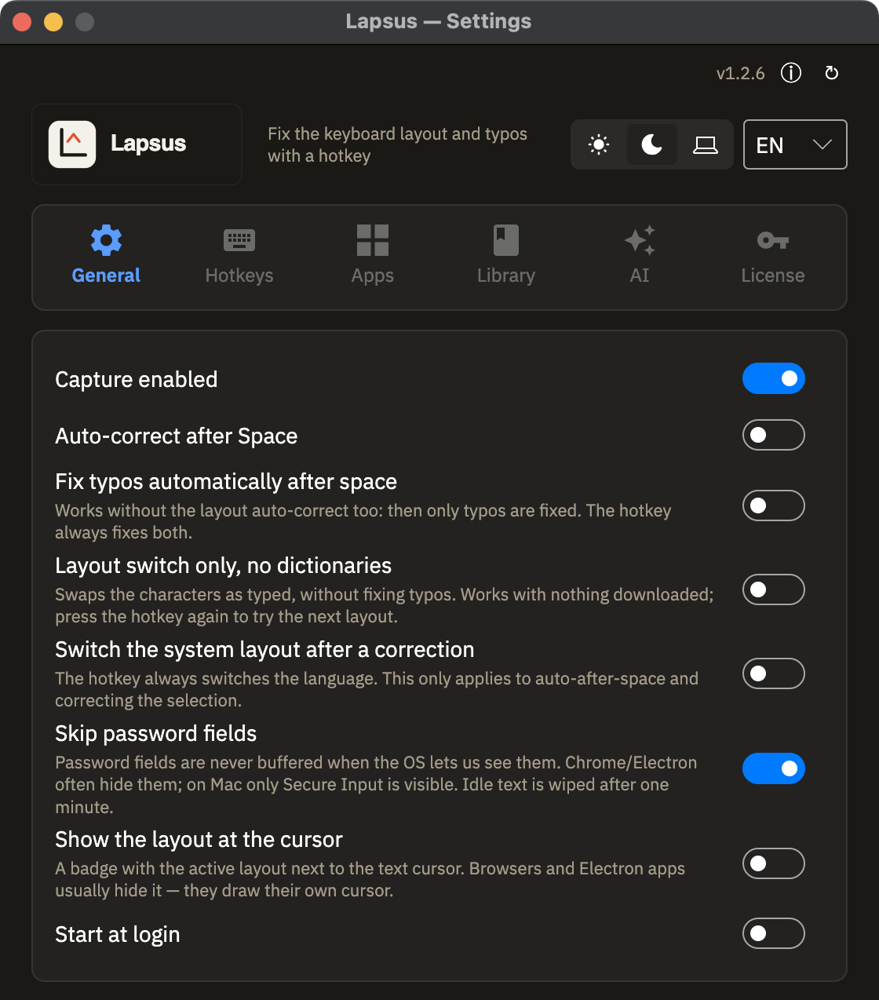
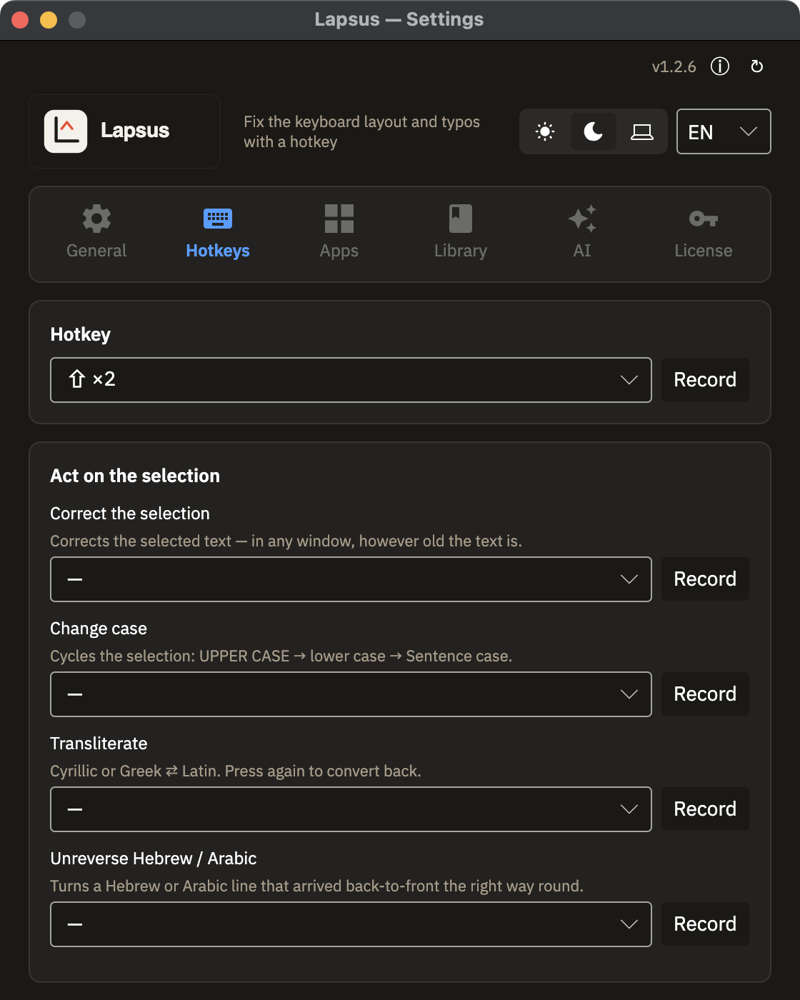
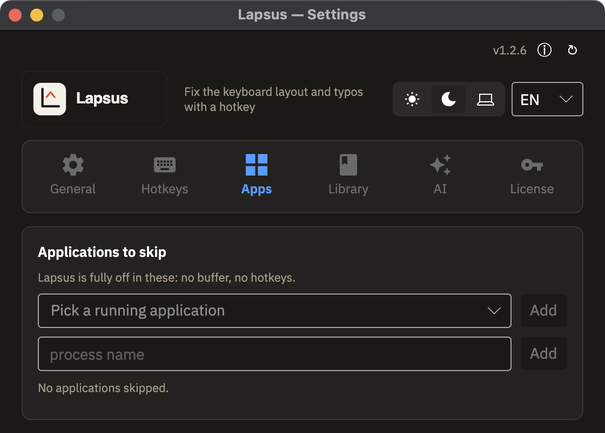
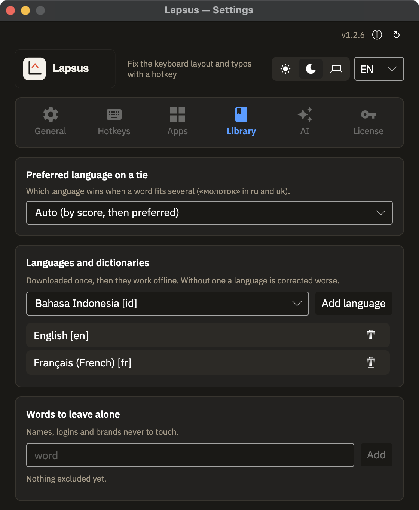
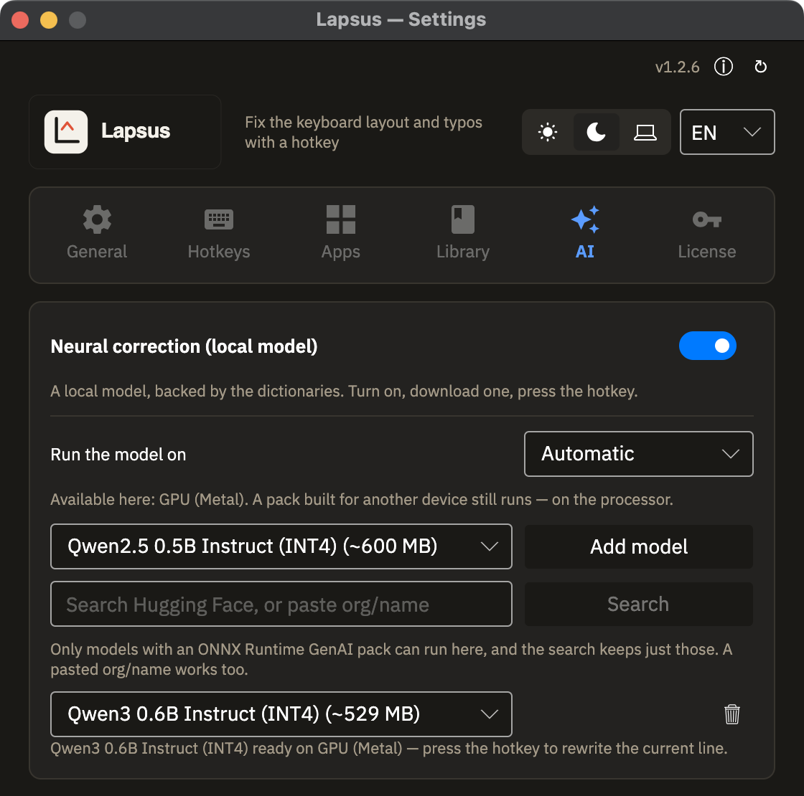
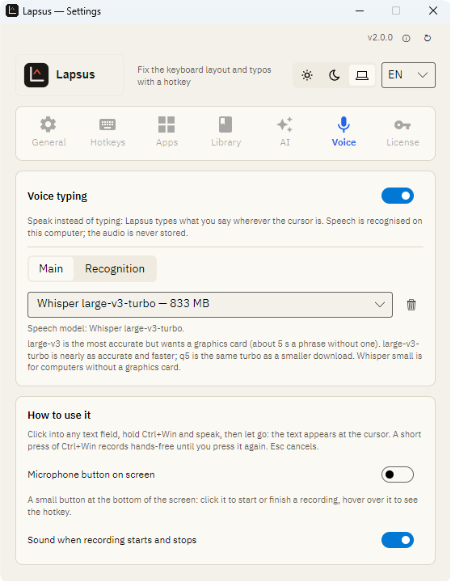

<div align="center">

<picture>
  <source media="(prefers-color-scheme: dark)" srcset="Lapsus/Assets/theme-dark.svg">
  
</picture>

### Types the word you meant, not the keys you hit.

Wrong-layout and typo corrector for Windows and macOS. Works in any app, runs only on your machine.

[](https://getlapsus.com/)
[](https://github.com/AleksandrPidlozhevich/Lapsus/releases)
[](#install)
[](#privacy)

</div>

---

Press one hotkey — the line is fixed in place. No retyping, no waiting for the OS to switch layout.

| You typed | You get |
|-----------|---------|
| `dsnfyyz` | `вітання` |
| `ghbdtn` | `привет` |
| `kalhmera` | `καλημέρα` |
| `akuo` | `שלום` |
| `lvpfh` | `مرحبا` |
| `gamarjoba` | `გამარჯობა` |
| `ba8ev` | `բարև` |
| `dkssud` | `안녕` |
| `sch;n` | `schön` |
| `hello,` | `hello,` |

**Latin, Cyrillic, Greek, Hebrew, Arabic, Georgian, Armenian, Korean.**

## Install

<p>
  <a href="https://github.com/AleksandrPidlozhevich/Lapsus/releases/latest/download/Lapsus-win-Setup.exe"></a>
  <a href="https://github.com/AleksandrPidlozhevich/Lapsus/releases/latest/download/Lapsus-win-Portable.zip"></a>
  <a href="https://github.com/AleksandrPidlozhevich/Lapsus/releases/latest/download/Lapsus-win.msi"></a>
</p>
<p>
  <a href="https://github.com/AleksandrPidlozhevich/Lapsus/releases/latest/download/Lapsus-osx.dmg"></a>
</p>

Also on [getlapsus.com](https://getlapsus.com/) and the [latest release](https://github.com/AleksandrPidlozhevich/Lapsus/releases/latest).

- **Windows** — `Setup.exe` installs per-user (no admin). Not code-signed, so SmartScreen may warn — *More info* → *Run anyway*. Portable `.zip` needs no installer. MSI is for IT ([msiexec notes](#msi-for-it)).
- **macOS** — Apple silicon `.dmg`, notarized by Apple. Grant **Accessibility** and **Input Monitoring** on first run.

Updates come from the tray menu. Nothing else to install.

## What it can do

- **Fix the current line** on a hotkey. Press again to cycle other readings, again to restore exactly what you typed.
- **Fix a word after Space** (opt-in). Leaves `myVar`, URLs, ALL-CAPS and very short words alone — unless the line has already switched, then `d` follows as `в`. Out of the box only layouts switch; typo fixing on the fly is a second switch (a name one letter from a dictionary word is not a typo). Backspace right after a fix restores what you typed; a word you put back three times is left alone from then on.
- **Undo Caps Lock / Shift slips**: `hELLO HOW ARE YOU` → `Hello how are you`, `HEllo` → `Hello`. Same hotkey; with typo fixing on, also after Space. `iPhone`, `mRNA`, `IDs` stay as they are.
- **Fix a selection** — any text, any age, even after a mouse click. Clipboard is borrowed and handed back exactly as it was.
- **Three more selection keys** (no dictionary needed): cycle **case** (UPPER → lower → Sentence → Every Word, Greek final sigma included); **transliterate** Cyrillic/Greek ⇄ Latin (Ukrainian 2010, Bulgarian 2009, Belarusian, Macedonian, Russian, ELOT 743 for Greek); turn a **visually reversed** Hebrew or Arabic line the right way round.
- **Layout badge** (opt-in) next to the caret — so the mistake does not happen. In browsers and Electron apps the badge flashes by the pointer when the layout changes; it also flashes blue where a word was fixed without being asked.
- **Voice typing** (opt-in): hold Ctrl+Win (⌃⌥ on Mac) while you speak and let go; a short press records until the next one. English terms stay Latin (`pull request`, `GitHub`); a glossary teaches your own names. [More below.](#voice-typing-optional)
- **Stay out of the way**: skip named apps entirely, or “Hotkey only” (hotkey + selection keys, no Space fix — for editors/terminals). Password fields never reach the buffer. Chinese / Japanese / Korean IME typing is left to the IME; with the English layout on, `dkssud` still fixes on the hotkey, and a selection fixes either way round.
- **Pause** from the tray (15 min, an hour, or until you bring it back). On Windows it steps aside during a full-screen game.
- **New layout notice**: if a layout has no dictionary yet, Library offers it in one click — nothing downloads until you ask.
- **Export / import** settings, leave-alone words and excluded apps to another computer.
- **First launch** walks through what Lapsus does, downloads word lists for your layouts, and gives a field to try the hotkey. Settings can show it again and keeps a count of fixes.
- **26 UI languages**, right-to-left included.

### Three brains, one hotkey

| Brain | Needs | What it does |
|-------|-------|--------------|
| **Dictionary** (default) | a word list | Ranks every reading — as typed, remapped through each layout, each also typo-fixed — and switches only past a confidence threshold. |
| **Layout switch only** | nothing | One character for another. No word list, no threshold. |
| **Neural** (opt-in) | a local model | A small LLM picks among the same readings in context; the dictionary brain advises when a word list is installed, and stands in while the model is not loaded. |

## Screenshots

<table>
  <tr>
    <td width="50%"></td>
    <td width="50%"></td>
  </tr>
  <tr>
    <td></td>
    <td></td>
  </tr>
  <tr>
    <td></td>
    <td></td>
  </tr>
</table>

## Dictionaries

Not bundled — nothing downloads until you click Download in **Settings → Library**. **35** languages across the eight scripts: a frequency list, and for most of them also Hunspell so a rare word form still counts. Sources and licenses are in [THIRD-PARTY-NOTICES.md](THIRD-PARTY-NOTICES.md). Files live in `%APPDATA%\Lapsus\dictionaries` (platform-equivalent on macOS), outside the install folder.

## Local models (optional)

**Settings → AI** turns the neural brain on. Four curated packs — Qwen3 0.6B (default), Qwen2.5 0.5B, Qwen3 1.7B, Phi-3.5 mini — plus a Hugging Face search that keeps only runnable ONNX GenAI packs. Pick **Auto / CPU / GPU** (DirectML on Windows, WebGPU on Apple Silicon, CUDA where a pack ships it; always falls back to CPU). A short correction is roughly a third of a second on a small pack. Files: `%APPDATA%\Lapsus\models\{id}`.

## Voice typing (optional)

**Settings → Voice** downloads the speech model; the hotkey is on the Hotkeys tab. Hold while you speak and let go, or tap once for hands-free and tap again to finish — Esc throws it away. A microphone badge sits at the cursor; a short tone marks start and end (can be turned off). On Windows a small button at the bottom of the screen starts or finishes without taking focus. The password-field setting does not apply — dictation only types into the field.

- **Whisper** large-v3-turbo (default), a smaller download of the same, full large-v3, or Whisper small — GPU where available (Vulkan / Metal), else CPU.
- **No GPU?** Parakeet TDT v3 is suggested (~⅓ s/phrase on CPU, 25 European languages). English-only layouts get Parakeet TDT v2; Hebrew gets ivrit.ai’s turbo fine-tune; Georgian / Armenian get NVIDIA FastConformer for that language.
- **The model follows the layout** — each dictation picks a downloaded model for that language. Long speech is typed in chunks as you pause. English terms stay Latin (`пулл реквест` → `pull request`); the glossary takes your own (`Kubernetes|кубер`) and can learn from a backspace-and-retype right after dictating. Silence is cut with Silero VAD before recognition.
- On a Mac the first dictation asks for the microphone. Models land in `%APPDATA%\Lapsus\speech`.

## Privacy

Everything runs on your computer. No telemetry, no account, no cloud for your text. Voice stays in memory until it is typed.

Online only when you download dictionaries or models, check for updates, or activate a license. Full policy: [getlapsus.com/en/privacy/app](https://getlapsus.com/en/privacy/app/).

## Price

**Free for private use** (freelancers included). Organisations need a per-seat license after a 30-day trial — [pricing](https://getlapsus.com/en/pricing/). Reminder only on managed PCs; nothing is locked.

## MSI for IT

```cmd
msiexec /i Lapsus-win.msi /qn ALLUSERS=1 VELOPACK_INSTALLDIR="C:\Program Files\Lapsus"
msiexec /i Lapsus-win.msi /qn VELOPACK_INSTALLDIR="%LocalAppData%\Lapsus"
```

Always set `VELOPACK_INSTALLDIR`. Individuals should use `Setup.exe` (in-app updates without elevation).

## License & building

[Business Source License 1.1](LICENSE) — see [COMMERCIAL-USE.md](COMMERCIAL-USE.md). Third-party notices: [THIRD-PARTY-NOTICES.md](THIRD-PARTY-NOTICES.md).

```bash
dotnet run --project Lapsus/Lapsus.csproj
```

Installers: **[scripts/BUILDING.md](scripts/BUILDING.md)**.
